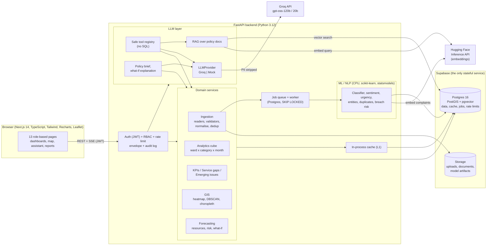
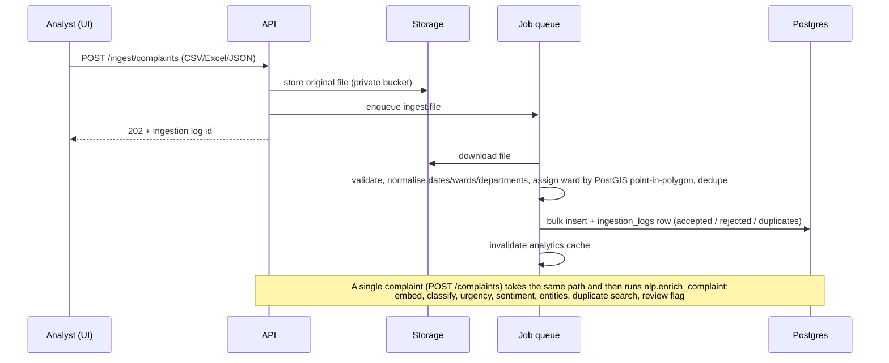
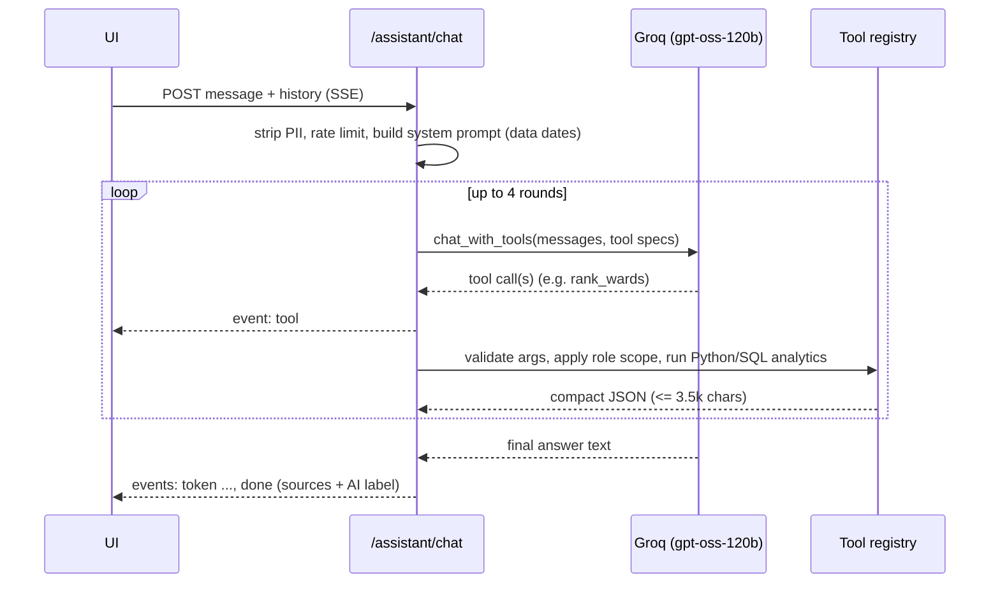

# Architecture

SG-DSS is a three-tier web application: a **Next.js** single-page dashboard, a **FastAPI** backend that contains all analytics, ML and LLM logic, and **Supabase** (managed Postgres with PostGIS and pgvector, plus object storage) as the only stateful service. Groq (LLM) and the Hugging Face Inference API (embeddings) are called over HTTPS by the backend only.

## System diagram



## Layers and responsibilities

| Layer | Where | Responsibility |
|---|---|---|
| UI | `frontend/src/app/(app)/*`, `components/`, `lib/` | Role-filtered navigation, pages, charts (Recharts), map (react-leaflet + OpenStreetMap), SSE chat client, CSV/print reports. Holds no business logic: every number comes from the API. |
| HTTP | `backend/app/api/v1/*` | One router per area. Every endpoint depends on `get_current_user` or `require_roles(...)`. All responses use the `{success, data, error}` envelope. |
| Domain | `backend/app/services/*`, `app/ingestion/*` | KPIs, service gaps, emerging issues, GIS, forecasting, jobs, cache, storage, audit. |
| ML / NLP | `backend/app/ml/*`, `app/nlp/*` | Classification, sentiment, urgency, entities, duplicates, breach risk, forecasting. Lightweight CPU models, artifacts versioned in `model_runs` + Storage. |
| LLM | `backend/app/llm/*` | Provider interface (`complete`, `chat`, `chat_with_tools`, `stream`), Groq and mock providers, cached and logged `generate()`, tool registry, RAG, brief, prompts as files. |
| Data | Supabase Postgres | Relational data, PostGIS geometries, pgvector (`halfvec`) embeddings, plus cache / jobs / rate limits tables. |

## Key flows

**1. Ingestion and enrichment**


**2. An analytics request** (e.g. KPI summary)
`browser -> JWT check -> scope by role (ward officer / department head) -> cube (in-process memo, else Postgres cache, else one aggregate SQL) -> pandas aggregation -> envelope`. The cube is one query grouped by ward x category x month and is reused by KPIs, service gaps, choropleths and forecasts. Analytics are relative to the newest complaint date, not the wall clock.

**3. "Ask the data"** (SSE)

If the model rejects tool calling (HTTP 400), a JSON-mode planner returns `{function, args}` which is validated against the same registry. The LLM never sees raw tables and never writes SQL.

**4. RAG** `question -> embed (HF API) -> pgvector cosine top-4 (HNSW on document_chunks) -> prompt with numbered excerpts -> Groq -> answer with [n] citations + source list`. If embeddings are unavailable, keyword overlap is used.

## Cross-cutting design decisions

| Topic | Decision | Why |
|---|---|---|
| Single external data service | Postgres does data, cache (`cache_entries`), jobs (`jobs`, `FOR UPDATE SKIP LOCKED`) and rate limits (`rate_limits`); Storage holds files | One account to set up; no Redis/Celery to run. Trade-off: every cache hit is a DB round trip, hence the in-process L1 layer. |
| No local ML models | Embeddings from Hugging Face's API, LLM from Groq, everything else is scikit-learn/statsmodels on CPU | Laptop-friendly; nothing large to download. BERTopic/Prophet were replaced by TF-IDF+NMF and statsmodels. |
| LLM is a narrator, not a calculator | All numbers come from Python/SQL; the LLM selects tools and writes prose; outputs are labelled AI-generated with model, source and demo flag | Prevents invented figures and keeps results auditable. |
| PII | Masked in API views (except admin and ward officers); regex-stripped from every text sent to Groq or Hugging Face | Privacy by default. |
| RBAC and scoping | `require_roles` per endpoint; ward officers / department heads are forced to their own ward / department by `scope_filters` | Enforced server-side; the UI hiding pages is only a convenience. |
| Row-level security | Every table has RLS enabled with no policies, so Supabase's public REST API cannot read data; only the backend's direct DB role can | Defence in depth for a public-key-exposed platform. |
| Storage budget | `halfvec` embeddings (768 B), HNSW index only on document chunks, 50k complaints = ~185 MB of 500 MB | Fits the free tier. |
| Time handling | Everything is "as of" the newest complaint | The demo dataset always has a meaningful current month. |
| Failure behaviour | LLM down -> deterministic template summaries and a clear 503 for assistant calls; HF down -> keyword RAG and text-only duplicate detection; Groq 429 -> Retry-After backoff | Core dashboards never depend on an external AI service. |

## Deployment shapes

* **Local (documented in the README):** `uvicorn` + `next dev` against a hosted Supabase project. `JOBS_INLINE=true` runs background jobs in the API process; run `tasks.py worker` instead for durability.
* **Docker (optional):** `docker-compose.yml` runs local Postgres + backend + frontend if you do not want to use Supabase for development. It is not required.
* **Production notes:** place the API in the same region as the database (latency is dominated by round trips), serve the frontend behind HTTPS, store tokens in httpOnly cookies instead of `localStorage`, and add server-side token revocation. See the limitations in [EVALUATION.md](EVALUATION.md#9-limitations).

## Repository map

```
backend/app/{api,core,db,ingestion,llm,ml,nlp,schemas,services,workers}   FastAPI app
backend/scripts/                 seed, data generator, training, evaluation, doc generators
backend/tests/                   pytest (real Supabase test schema, Groq mocked)
frontend/src/{app,components,lib}  Next.js app
data/                            ward GeoJSON, departments, sample files, 8 policy/report documents
docs/                            this documentation
scripts/tasks.py                 cross-platform task runner (replaces the Makefile)
```
