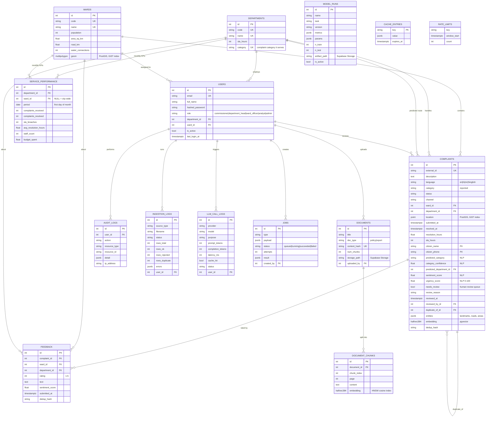

# Database

PostgreSQL 16 on Supabase with the **PostGIS** and **pgvector** extensions (enabled by migration `0001`, never by hand). Schema changes are Alembic migrations in `backend/app/db/migrations/versions/` (`0001`-`0005`). Enums are stored as strings, not native PG enums. Every table has **row-level security enabled with no policies**: only the backend's direct database role can read or write.

## Entity-relationship diagram

`model_runs`, `cache_entries` and `rate_limits` have no foreign keys (they are infrastructure tables).

## Indexes worth knowing

| Index | Purpose |
|---|---|
| `complaints(ward_id, submitted_at)`, `(category, submitted_at)`, `(department_id, status)` | Filtering and the analytics cube |
| GiST on `complaints.location` and `wards.geom` | Point-in-polygon ward assignment, radius search (`ST_DWithin`), heatmaps |
| HNSW (`halfvec_cosine_ops`) on `document_chunks.embedding` | RAG retrieval |
| none on `complaints.embedding` | Duplicate search prefilters by ward and a 72-hour window, then compares exactly (keeps storage low) |
| Partial unique `service_performance(department_id, period) WHERE ward_id IS NULL` | One city-wide row per department per month |
| `complaints.dedup_hash`, `feedback.dedup_hash` | Idempotent re-imports (duplicates are detected on text + ward + day + citizen) |

## Data lifecycle

1. `scripts/generate_data.py` writes deterministic CSV/GeoJSON/PDF/DOCX files (seed 42) under `data/generated/` (git-ignored).
2. `tasks.py seed` loads them through the real ingestion pipeline (validation, normalisation, ward assignment, dedup).
3. `tasks.py train` trains the models and `tasks.py predict` writes `predicted_category`, `category_confidence`, `sentiment_score`, `urgency_score`, `needs_review`, `entities`, `duplicate_of_id` back to `complaints`.
4. Embeddings (`complaints.embedding`, `document_chunks.embedding`) are computed through the Hugging Face API and stored as `halfvec(384)`.
5. Size at the end of the build: 50,000 complaints, 20,142 feedback, 7,290 performance rows, 8 documents (20 chunks) = **184.6 MB of the 500 MB** free tier (`tasks.py db-size`).
